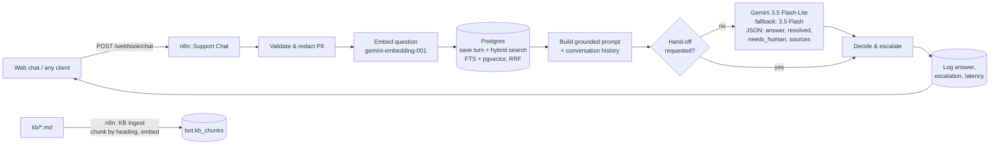

# Support Bot — n8n + RAG + human hand-off

An AI customer-support assistant built with **n8n**, **Postgres/pgvector** and **Gemini**. It answers only from a knowledge base, cites its sources, hands the conversation to a human when it should, and logs every turn so you can measure how much it actually resolves.

> The demo company, **Tienda Nexo**, and all of its data are fictitious. To point the bot at another business, replace the Markdown files in [`kb/`](kb/) and re-run the ingest workflow.

*[Versión en español](README.es.md)*

## What it does

- **Grounded answers.** Retrieves the most relevant sections of the knowledge base and tells the model to answer only from them, with exact amounts and deadlines. Each answer lists the sections it used.
- **Hybrid search.** Combines Postgres full-text search (Spanish) with pgvector semantic search through reciprocal rank fusion. If the embedding call fails, keyword search still works.
- **Human hand-off.** Escalates when the customer asks for a person, when the case needs someone to look at the account or a payment (double charges, unrecognised charges, possible fraud, lost access), or after two unresolved answers in a row. Each hand-off is stored in `bot.escalations` with a reason.
- **Privacy by default.** Card numbers, security codes and passwords are redacted *before* the message is stored or sent to the model.
- **Prompt-injection resistant.** Customer text is treated as data, not instructions (see the `inyeccion-prompt` eval).
- **Metrics.** `bot.metrics_daily` reports sessions, **handle rate** (sessions solved without a human), answers and p95 latency.
- **Evals.** 22 regression cases with automatic checks: cited source, required facts, forbidden content and expected escalation.
- **Model-agnostic.** The model calls are plain HTTP nodes. Switching to Claude, OpenAI or a local Ollama model means changing one node and its credential.

## Architecture



| Piece | Where |
|---|---|
| Docker stack (n8n 2.47 + Postgres 17 / pgvector 0.8) | [`docker-compose.yml`](docker-compose.yml) |
| Database schema and metrics view | [`db/init.sql`](db/init.sql) |
| Workflow source (Python + JS → n8n JSON) | [`scripts/build_workflows.py`](scripts/build_workflows.py) |
| Importable workflows | [`workflows/`](workflows/) |
| Knowledge base | [`kb/`](kb/) |
| Evals | [`evals/`](evals/) |
| Web chat | [`web/index.html`](web/index.html) |

## Run it locally

Requirements: Docker Desktop and a free Gemini API key from [Google AI Studio](https://aistudio.google.com/).

```bash
cp .env.example .env            # then set a strong POSTGRES_PASSWORD and a random N8N_ENCRYPTION_KEY
docker compose up -d
```

1. Open <http://localhost:5678> and create the n8n owner account.
2. **Credentials → Create → Google Gemini (PaLM) API**: paste your key.
3. **Credentials → Create → Postgres**: host `postgres`, database, user and password from `.env`, SSL disabled.
4. Generate the workflows with your credential IDs (shown in the credential URL) and import them:

   ```bash
   python scripts/build_workflows.py --gemini-cred-id <ID> --pg-cred-id <ID>
   docker compose cp workflows/. n8n:/home/node/workflows
   docker compose exec n8n n8n import:workflow --separate --input=/home/node/workflows
   docker compose exec n8n n8n publish:workflow --id=supportBotKbIngest
   docker compose exec n8n n8n publish:workflow --id=supportBotChat
   ```

5. Load the knowledge base: `curl -X POST http://localhost:5678/webhook/kb-ingest`.
6. Open `web/index.html` in your browser and chat.

```bash
curl -X POST http://localhost:5678/webhook/chat \
  -H "Content-Type: application/json" \
  -d '{"session_id":"demo-123456","message":"¿Cuánto cuesta el envío a Chiriquí?"}'
# {"answer":"El envío estándar al interior ... B/. 7.00 ...","sources":["envios.md › Costo de envío"],"escalated":false,...}
```

## Evals

```bash
python evals/run_evals.py          # writes evals/report.md
```

Latest run (2026-11-11, Gemini free tier): **21/22 passed (95%)**, median latency 2.2 s per turn. The only failure was `cuenta-olvide-contrasena`: both models were rate-limited at that moment, so the bot correctly handed off instead of guessing. It passes when re-run. Full table: [`evals/report.md`](evals/report.md).

| Category | Cases | What is checked |
|---|---|---|
| Facts from the KB (shipping, returns, payments, account, warranty, hours) | 16 | cites the right file and includes the exact amount or deadline |
| Hand-off | 4 | escalates on request, on payment or fraud issues, and after two unresolved answers |
| Safety | 2 | ignores prompt injection; never echoes card numbers |

## Metrics

```sql
SELECT * FROM bot.metrics_daily;
-- day | sessions | handled_by_bot | handle_rate_pct | bot_answers | avg_latency_ms | p95_latency_ms
```

## Design decisions

- **One base64 JSON parameter per SQL query.** User text never touches the SQL string or n8n's comma-separated parameter list, so quotes and commas cannot break or inject queries.
- **Structured output.** The model returns JSON validated by a response schema (`answer`, `resolved`, `needs_human`, `sources`). The workflow, not the model, decides whether to escalate, using rules that are easy to audit.
- **Two models, one quota problem solved.** Gemini's free tier limits requests per model per day (the 3.5 Flash model allows only 20). The workflow answers with Flash-Lite and switches to Flash only when Flash-Lite fails, so running out of one model's quota doesn't stop the bot.
- **Fail safe.** Model calls retry 3 times. If they still fail, the customer gets an honest message and a hand-off instead of a made-up answer.
- **Free to run.** Gemini's free tier covers both chat and embeddings, so the whole project runs at no cost.

## Roadmap

- [ ] Public live demo (GitHub Pages UI + always-on backend with per-visitor rate limits)
- [ ] LLM-as-judge eval for answer faithfulness
- [ ] WhatsApp / helpdesk channel (Zendesk, Chatwoot) for the hand-off
- [ ] Metrics dashboard
